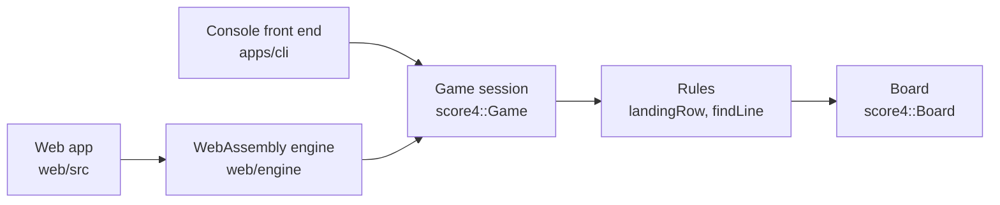
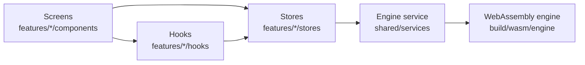

# Architecture

Score 4 has two parts: a **game core** that knows the rules, and **front ends** that talk to people. The core never
reads input or prints anything, so the same core runs behind the console and behind the web page.

Data moves one way: a front end asks the game to do something, the game uses the rules, and the rules read the board.
Nothing in the core knows a front end exists.

## The parts

| Part    | Files                                       | What it does                                                                                                                                                                                                    |
| ------- | ------------------------------------------- | --------------------------------------------------------------------------------------------------------------------------------------------------------------------------------------------------------------- |
| Board   | `include/score4/board.hpp`, `src/board.cpp` | Holds the 6 × 7 grid. Each spot is empty, red or yellow. Spots outside the grid read as empty.                                                                                                                  |
| Rules   | `include/score4/rules.hpp`, `src/rules.cpp` | `landingRow` says where a coin dropped into a column ends up. `findLine` says which colour, if any, has four in a line, and which four spots make that line.                                                    |
| Game    | `include/score4/game.hpp`, `src/game.cpp`   | One game from the first move to the end: whose turn it is, each player's colour, and the result of each move (still playing, a win, or a tie). Also the setup rules: who starts, and which colours are allowed. |
| Console | `apps/cli/`                                 | Asks for ages, colours and columns, draws the board as text, and prints the result. It only calls the game.                                                                                                     |

## The game's API

| Call                                                 | Gives back                                                                                                                                                                                                                                                                                                                       |
| ---------------------------------------------------- | -------------------------------------------------------------------------------------------------------------------------------------------------------------------------------------------------------------------------------------------------------------------------------------------------------------------------------- |
| `startingPlayer(ageOne, ageTwo)`                     | The player who starts: the younger one, or Player 1 if they are the same age.                                                                                                                                                                                                                                                    |
| `parseDisc("R")`                                     | Red, Yellow, or nothing if the text is not exactly `R` or `Y`.                                                                                                                                                                                                                                                                   |
| `parseOtherDisc(text, taken)`                        | Like `parseDisc`, but also nothing if the colour is already taken.                                                                                                                                                                                                                                                               |
| `Game(discOne, discTwo, starter)`                    | A new game with an empty board.                                                                                                                                                                                                                                                                                                  |
| `game.drop(column)`                                  | For a column from 1 to 7: the outcome after the move (`InProgress`, `Won{player, line}` or `Tie`). `line` is the four spots of the winning line, so a screen can mark them. For any other number: the error `ColumnOutOfRange`; for a full column: `ColumnFull`; after a win or a tie: `GameOver`. In each case nothing changes. |
| `game.board()`, `game.turn()`, `game.discOf(player)` | The current board, whose turn it is, and a player's colour.                                                                                                                                                                                                                                                                      |

## Tests

| Test                                  | What it checks                                                                                                                            |
| ------------------------------------- | ----------------------------------------------------------------------------------------------------------------------------------------- |
| `tests/rules_test.cpp`                | Every rule, case by case: landing spot, four across, up and down, each diagonal, three is not enough, full board.                         |
| `tests/game_test.cpp`                 | Who starts, colour choices, refused columns, turns, who wins, the tie.                                                                    |
| `tests/cli_characterization_test.cpp` | Runs the console program with each recorded input (`tests/fixtures/cli/*.in`) and checks the output is the same, character for character. |

## The web app

The web app in `web/` is a React app. It never knows the rules: every move goes to the same C++ game core, compiled
to WebAssembly.

| Part           | Folder                                                                                               | What it does                                                                                                                                                                                                                                                   |
| -------------- | ---------------------------------------------------------------------------------------------------- | -------------------------------------------------------------------------------------------------------------------------------------------------------------------------------------------------------------------------------------------------------------- |
| Engine binding | `web/engine/bindings.cpp`                                                                            | Gives the game core to JavaScript: start a match, drop a coin, read a column, the winner and the winning line.                                                                                                                                                 |
| Engine service | `web/src/shared/services/engine-service.ts`                                                          | The only code that loads and calls the WebAssembly engine. It loads it once and checks every value the engine gives back (with Zod) before turning it into a plain TypeScript type. After a failed load it keeps the error until the player asks to try again. |
| Setup          | `web/src/features/setup/`                                                                            | Asks for both ages, asks the engine who starts, and lets that player pick a colour.                                                                                                                                                                            |
| Game           | `web/src/features/game/`                                                                             | One game: the board, whose turn it is, the result, the full-column message, Play again and New game.                                                                                                                                                           |
| Forest         | `web/src/forest/`                                                                                    | The Material 3 parts (buttons, text field, dialog, snackbar, app bar). They know nothing about Score 4, so they can move to a shared package later.                                                                                                            |
| Shared         | `web/src/shared/`                                                                                    | The board, coins and player tags, used by both setup and game, and the Theme button in both app bars.                                                                                                                                                          |
| Theme          | `web/src/shared/stores/theme-store.ts`, `web/src/shared/services/theme-service.ts`, `web/index.html` | The player's colour theme: System (the default), Light or Dark. The service is the only code that touches `localStorage` (key `theme`) and the page's `data-theme` and `theme-color` tags; the store holds the current choice for the whole app.               |
| App            | `web/src/app/`                                                                                       | Switches between setup and game, and passes the chosen players and colours from one to the other.                                                                                                                                                              |

How the screens fit together:

- **Setup and game never import each other.** The app gives each one what it needs and listens for what it reports
  ("start this game", "go back", "new players").
- **Each screen has its own store.** A store is created when its screen appears and thrown away with it, so a new
  game always starts clean and every test gets a fresh one.
- **Going back keeps the setup.** The setup screen is hidden, not removed, while a game is on, so Back returns to the
  same colour choice.
- **Loading and errors have their own screens.** While the engine or the game screen's code loads, the game shows
  "Getting ready". If either fails, it shows "The game couldn’t start" with Try again.
- **The board and the new game dialog download when needed.** They are split from the first download and fetched
  as soon as the player presses Continue, so they are usually ready before Start game.
- **No effects.** Nothing in the web app runs "after render". Everything happens in response to something the player
  did, or while the screen is drawn.
- **The theme is set before the app starts.** A short script in `index.html` reads the saved choice and marks the
  page (`data-theme`) before anything is drawn, so a returning player never sees the wrong colours flash. Choosing
  in the Theme sheet or dialog saves the choice and marks the page again at once. On System the browser itself
  follows the device setting, live, through CSS; no code has to watch it. A choice made in another tab reaches this
  one through the browser's `storage` event, listened to while a Theme button is on screen. The saved choice is
  read again whenever listening starts and when the browser restores the page from its back-forward cache, so a
  change made elsewhere meanwhile is not missed.
- **There is one Theme panel for the whole app.** It lives in the app shell (`theme-panel-host.tsx`), next to the
  screens, and `web/src/shared/stores/theme-panel-store.ts` says whether it is open. The Theme button on each app bar
  only asks the store to open it. So a screen that changes while the panel is open (an engine that fails to load, for
  example) does not close it, and closing returns focus to the Theme button that is on screen now.
- **The Theme picker is fetched on its own**, as soon as the pointer or keyboard focus reaches the Theme button; the
  sheet and dialog around it are in the first download. A press opens the sheet or dialog at once. If the picker is
  still downloading, a loading indicator labelled "Loading Theme" stands where the picker goes, and the picker takes
  its place in the same open surface when it arrives. Closing it while loading cancels the open. If the download fails
  while the surface is open, it closes, focus goes back to the Theme button, a snackbar says "Couldn’t open Theme. Try
  again." and the next press tries again; a failure after the player closed it says nothing. A closed surface leaves
  the page once its exit animation ends, and a press during that animation reopens the same surface.
- **Sheet or dialog is decided when Theme opens from nothing.** The Theme panel store
  (`web/src/shared/stores/theme-panel-store.ts`) makes the choice, and only when no panel is on screen: it asks
  `web/src/shared/utils/window-class.ts` for the window width (the 600 dp medium breakpoint, read from
  `--breakpoint-medium` in `web/src/styles/tokens.css`, its only home), so a phone gets a bottom sheet and a wider window
  gets a dialog. Once a panel is open, or still closing, it keeps that form: resizing the window does not change it, and
  pressing Theme while it closes reopens the same sheet or dialog. The choice is made again only after the panel has
  fully left the screen. `web/src/shared/hooks/use-theme-sync.ts`
  listens to the browser's `storage` event for the theme key in `localStorage`, and stops when the Theme button leaves
  the screen.

| Test                      | What it checks                                                                                                             |
| ------------------------- | -------------------------------------------------------------------------------------------------------------------------- |
| `web/src/**/*.test.ts(x)` | The engine service, the theme service, the stores, the board's keyboard and screen-reader behaviour, and the Theme button. |
| `web/e2e/*.spec.ts`       | The whole game in a real browser, at the phone width (412) and the desktop width (1024) used in Figma.                     |
