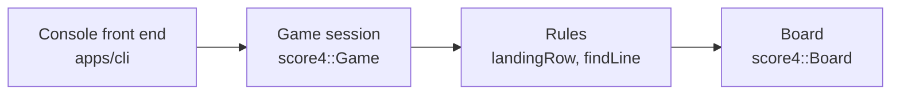

# Architecture

Score 4 has two parts: a **game core** that knows the rules, and **front ends** that talk to people. The core never
reads input or prints anything, so the same core runs behind the console and, later, the web page.

Data moves one way: a front end asks the game to do something, the game uses the rules, and the rules read the board.
Nothing in the core knows a front end exists.

## The parts

| Part | Files | What it does |
| --- | --- | --- |
| Board | `include/score4/board.hpp`, `src/board.cpp` | Holds the 6 × 7 grid. Each spot is empty, red or yellow. Spots outside the grid read as empty. |
| Rules | `include/score4/rules.hpp`, `src/rules.cpp` | `landingRow` says where a coin dropped into a column ends up. `findLine` says which colour, if any, has four in a line, and which four spots make that line. |
| Game | `include/score4/game.hpp`, `src/game.cpp` | One game from the first move to the end: whose turn it is, each player's colour, and the result of each move (still playing, a win, or a tie). Also the setup rules: who starts, and which colours are allowed. |
| Console | `apps/cli/` | Asks for ages, colours and columns, draws the board as text, and prints the result. It only calls the game. |

## The game's API

| Call | Gives back |
| --- | --- |
| `startingPlayer(ageOne, ageTwo)` | The player who starts: the younger one, or Player 1 if they are the same age. |
| `parseDisc("R")` | Red, Yellow, or nothing if the text is not exactly `R` or `Y`. |
| `parseOtherDisc(text, taken)` | Like `parseDisc`, but also nothing if the colour is already taken. |
| `Game(discOne, discTwo, starter)` | A new game with an empty board. |
| `game.drop(column)` | For a column from 1 to 7: the outcome after the move (`InProgress`, `Won{player, line}` or `Tie`). `line` is the four spots of the winning line, so a screen can mark them. For any other number: the error `ColumnOutOfRange`; for a full column: `ColumnFull`. In both cases nothing changes. |
| `game.board()`, `game.turn()`, `game.discOf(player)` | The current board, whose turn it is, and a player's colour. |

## Tests

| Test | What it checks |
| --- | --- |
| `tests/rules_test.cpp` | Every rule, case by case: landing spot, four across, up and down, each diagonal, three is not enough, full board. |
| `tests/game_test.cpp` | Who starts, colour choices, refused columns, turns, who wins, the tie. |
| `tests/cli_characterization_test.cpp` | Runs the console program with each recorded input (`tests/fixtures/cli/*.in`) and checks the output is the same, character for character. |

