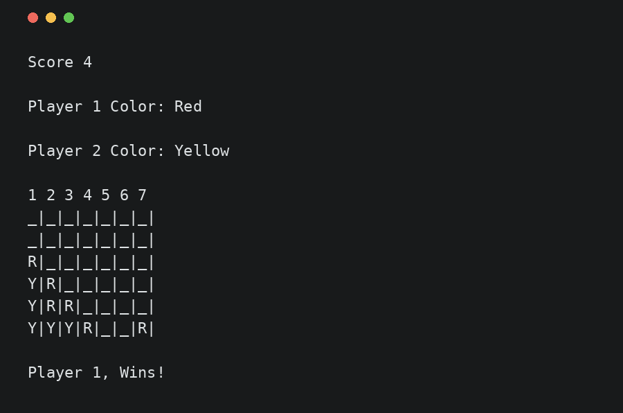
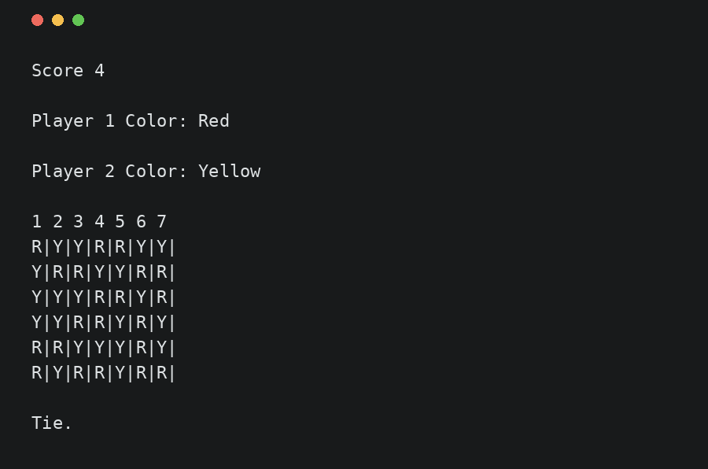

# score-4 — audit

Audited 2026-10-13 on branch `refresh/modernize`, from `master` at `bc90dd5`.

## What it is

A two-player Connect Four ("Score 4") game for the console, written in 2019 as a student project. All the code is one
file, `Score 4/Score 4 (NoGUI)/main.cpp` (355 lines, CRLF line endings). There is no build file, README, licence or
test. The remote branch `No-GUI` holds the same file at the repo root, with one line changed.

## How it was run

There is no build system, so it was compiled by hand with GCC 15.2 (Clang is not installed):

```sh
g++ -std=c++17 -O0 -w -o score4 "Score 4/Score 4 (NoGUI)/main.cpp"
```

**As built, the game cannot be played.** The loop that runs the turns checks a variable (`end`) that is never given a
value. With GCC 15 at `-O0`, `-O1` and `-O2` it holds a non-zero value, so the program stops right after the players
pick their colours (`as-built`). The author clearly meant it to start at 0. To record the intended behaviour, every
other flow uses a build that sets uninitialised locals to zero, without touching the source:

```sh
g++ -std=c++17 -O0 -w -ftrivial-auto-var-init=zero -o score4 "Score 4/Score 4 (NoGUI)/main.cpp"
```

The program calls `system("cls")` to clear the screen. That is a Windows command: on Linux every redraw prints
`sh: 1: cls: not found` to stderr and the screen is not cleared, so the boards pile up one under the other.

## Recorded flows

Each flow lives in `docs/portfolio/before/` as three files: `<flow>.in` (the exact input sent), `<flow>.txt` (the exact
stdout) and `<flow>.png` (the last screen, as a Windows user would see it after `cls`). Flows that never end on their
own were stopped and cut at the prompt named below. These `.txt` files are the expected outputs for the Phase 4
characterization tests.

| Flow | What it shows | How it ends |
| --- | --- | --- |
| `as-built` | Normal build: setup, then the program quits before the first move | exit 0 |
| `vertical-win` | Player 1 (younger) is Red, four in a column | `Player 1, Wins!` |
| `horizontal-win` | Player 2 is younger and starts; bad colour inputs (`x`, `r`, same colour, `G`) are asked again; four in the bottom row | `Player 2, Wins!` |
| `diagonal-win` | Equal ages; a diagonal rising to the left | `Player 1, Wins!` |
| `anti-diagonal-missed` | A diagonal rising to the right is **not** seen as a win; the game goes on | cut at the 12th column prompt |
| `column-out-of-range` | Columns `0`, `8`, `-3` are asked again; `5` is accepted | cut at the 5th column prompt |
| `tie` | All 42 cells filled with no win found | `Tie.` |
| `full-column` | A 7th coin into a full column overwrites the top coin; the column check then reads outside the board and the program crashes before it prints the next prompt (the redrawn board is lost with it) | segfault (exit 139) on the 8th move; output ends at the 8th column prompt |
| `non-numeric-input` | Typing `abc` as an age makes both ages 0, then the colour prompt repeats forever | cut at the 4th repeat |

## Behaviour checklist

The contract for "no behaviour lost". Items marked **bug** are kept as they are in Phase 4 (pinned by tests) and fixed
in Phase 5 only if the plan says so.

### Start

1. Prints `Welcome to the game known as...`, a blank line, `Score 4`, a blank line.
2. Prints the empty board once before setup: the header `1 2 3 4 5 6 7 ` (trailing space), then 6 rows of `_|` × 7, each
   row preceded by a newline and no newline after the last row.

### Setup

3. Asks Player 1's age, then Player 2's age (`\n\nWelcome Player N.\nGive me your age: `). Any integer is accepted,
   including 0 and negative numbers.
4. The younger player starts. Equal ages: Player 1 starts (`Player 1 starts cause is first.`). Player 1 younger:
   `Player 1 starts cause its smaller.` Player 2 younger: `Player 2 starts cause its smaller.`
5. The starting player picks a colour first, then the other player.
6. A colour must be exactly `R` or `Y` (upper case). Anything else, `r` and `y` included, asks again with the same prompt.
7. The second player cannot take the first player's colour; asking again uses the same prompt.
8. Prompt text differs by path: when Player 1 is younger, the first prompt ends `Yellow color: ` (no "coin"); every other
   colour prompt ends `Yellow color coin: `. The second player's prompt starts `\nPlayer N.\n`.

### Each turn

9. Every redraw clears the screen (`cls`) and prints `Score 4`, both players' colours as `Red`/`Yellow`, the column header
   and the board.
10. The prompt is `\n\nPlayer N\nPick the column you want to drop your coin (Between 1-7): `.
11. A column outside 1–7 asks again (same player, same prompt). The board is not redrawn.
12. The coin falls to the lowest empty cell of the column and is drawn as `R|` or `Y|`.
13. After a move the turn passes to the other player and the board is redrawn.
14. **bug**: a coin dropped into a full column overwrites the top coin, and the turn still passes.

### End of game

15. After every move the whole board is checked, in this order: rows, columns, diagonals, then a tie.
16. Four of a colour in a row (left to right) wins, for rows 2–6 counted from the top. **bug**: the top row is never
    checked. In practice four in the top row cannot happen first: it needs the row below to be full of the other colour
    (a win for them), or two equal coins at the top of a column (item 20).
17. Four of a colour in a column wins.
18. Four of a colour on a diagonal going down to the right (`\`) wins. **bug**: diagonals going up to the right (`/`) are
    never checked, so that win is missed and the game goes on.
19. The winner is found from the colour: `\n\nPlayer 1, Wins!\n` if that colour is Player 1's, else Player 2. Red is
    checked before Yellow in each group.
20. **bug**: the column check reads outside the board (row −1, −2) when the top two or three cells of a column hold the
    same colour. That is undefined behaviour: it crashed in `full-column`, and AddressSanitizer reports a heap overflow.
21. When all 42 cells are filled and nobody won: `\n\nTie.` (no final newline).
22. The program then exits with code 0. The board memory is never freed (LeakSanitizer reports it).

### Input errors

23. **bug**: a non-number where a number is expected puts the input stream in a failed state. Every later read fails at
    once, so the program loops forever printing the same prompt.
24. **bug**: on Linux/macOS `cls` does not exist; each redraw prints `sh: 1: cls: not found` to stderr.

## Debt and risks

| Area | Finding |
| --- | --- |
| Correctness | `end` never initialised: the game does not run as built (UB). Out-of-bounds read in the column check (UB, crash). `/` diagonals and the top row never checked. Full column overwritten. Bad numeric input loops forever |
| Portability | `system("cls")` is Windows-only. CRLF line endings |
| Code | One 355-line file; `using namespace std;` plus `std::` everywhere; `#define N 6`/`M 7`; C headers (`stdio.h`, `stdlib.h`, `ctype.h`) and `printf`; raw `new[]` with no `delete[]`; the board stores display strings (`"R|"`) instead of a cell state; the drop and win checks are copy-pasted per row and per diagonal; `GameBoard::circleColor` is never used; unused `col` in `setPlayers`, unused parameter `player_turn` in `Game`; misleading indentation in the tie check |
| Layout | Source sits under `Score 4/Score 4 (NoGUI)/` — nested, with spaces and parentheses in the path |
| Missing | Build system, tests, formatter/linter config, CI, `.gitignore`, `.editorconfig`, LICENSE, README |
| Secrets, binaries, deps | None: no credentials, no committed build output, no third-party dependencies |
| Comments | Descriptive comments throughout; all to be removed (anything worth keeping goes to `docs/rules.md`) |
| Branches | Remote `No-GUI` is the same code at the root; the name hints at a GUI version that is not in the repo |

## Before images

| | |
| --- | --- |
|  |  |
|  |  |
|  |  |
