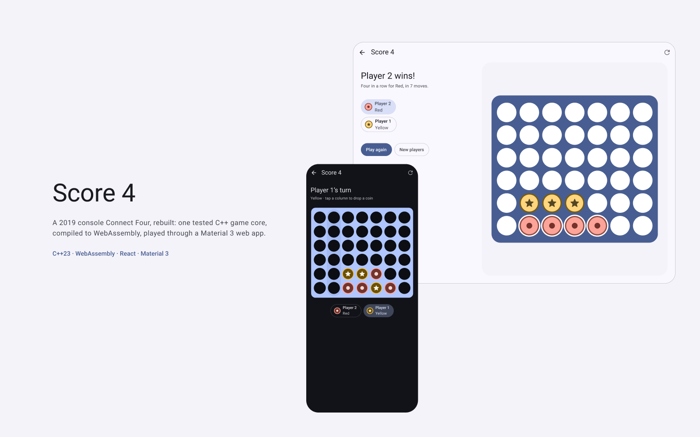
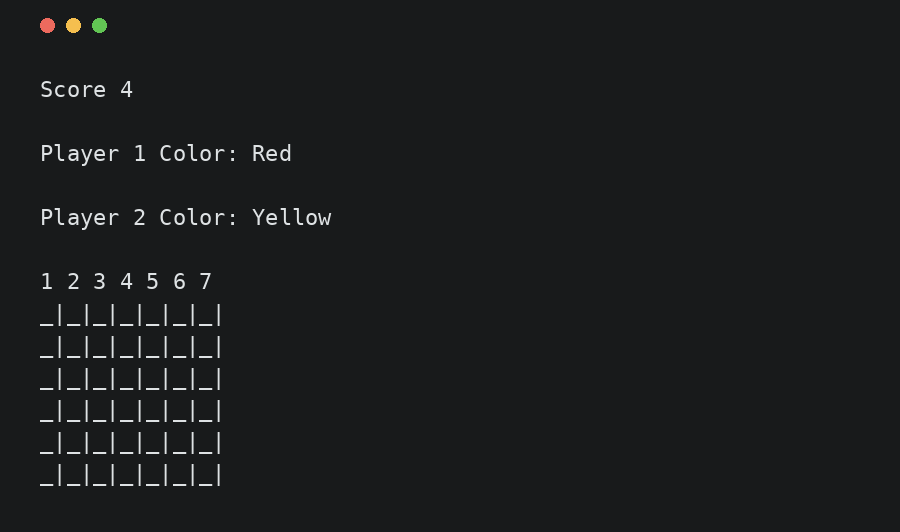
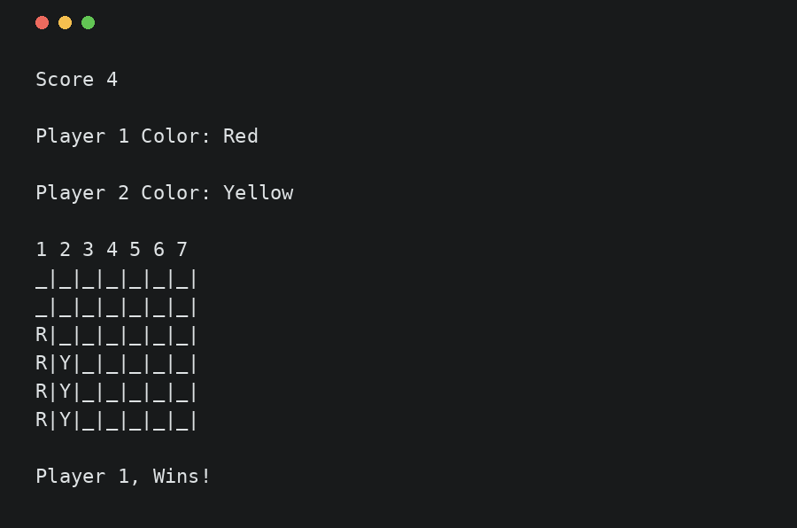
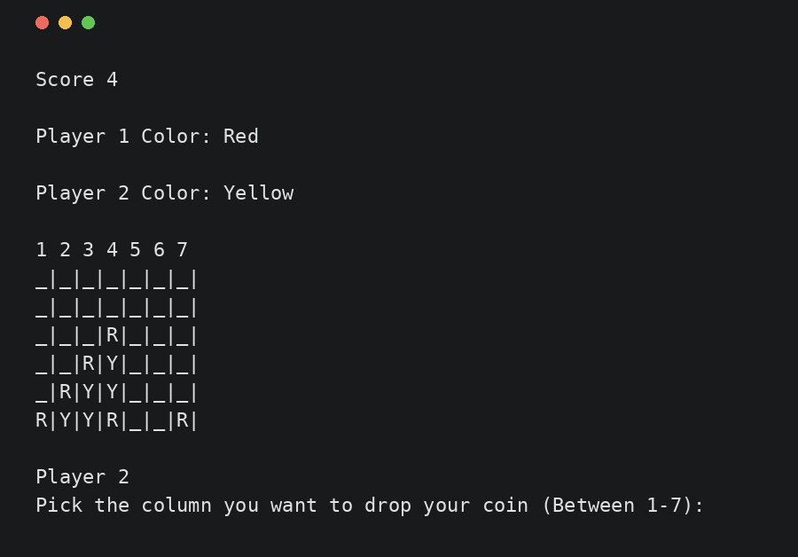
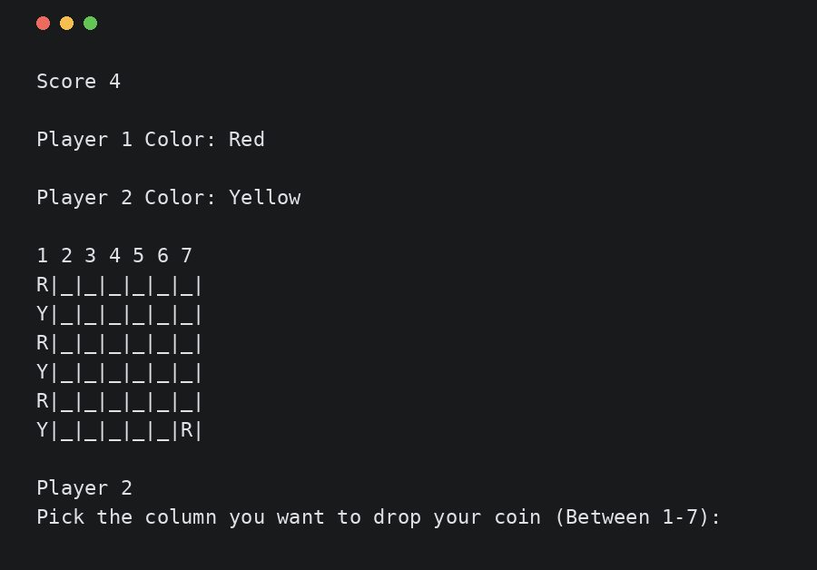
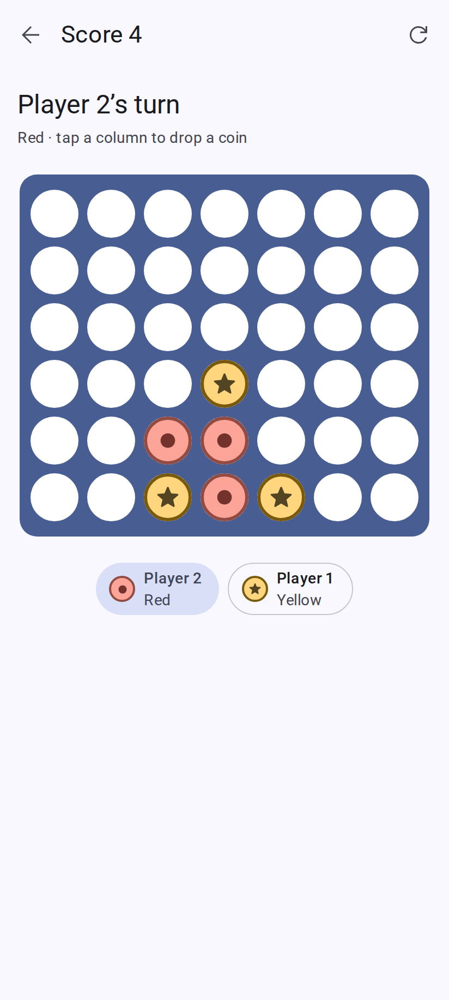
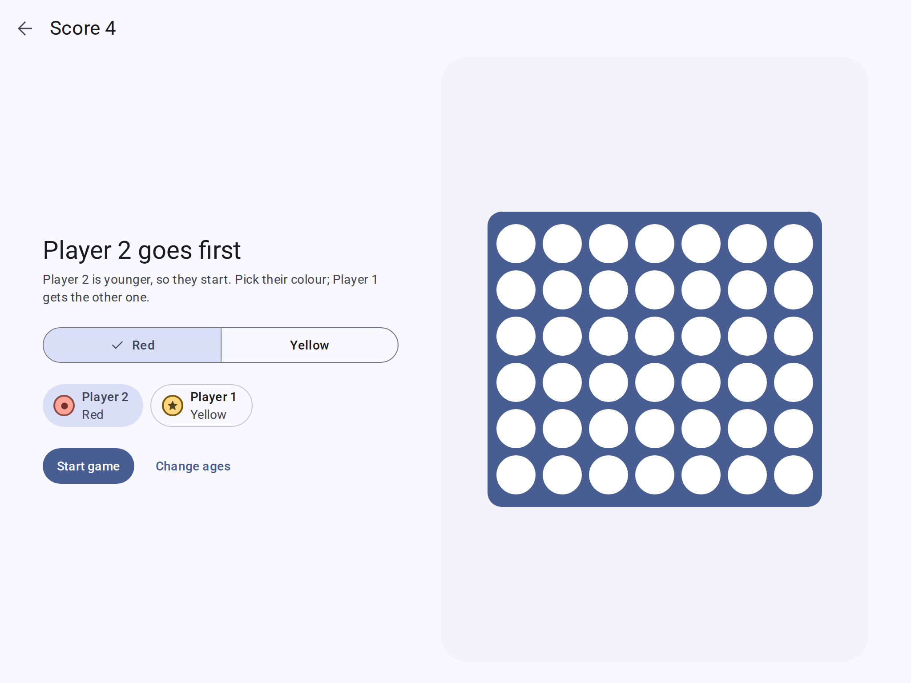
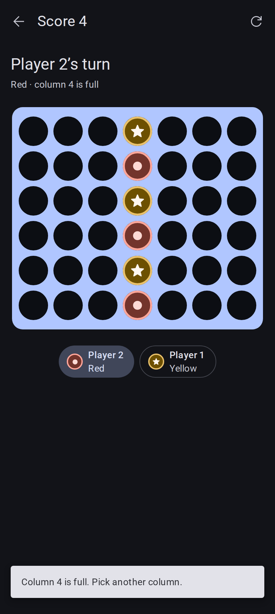
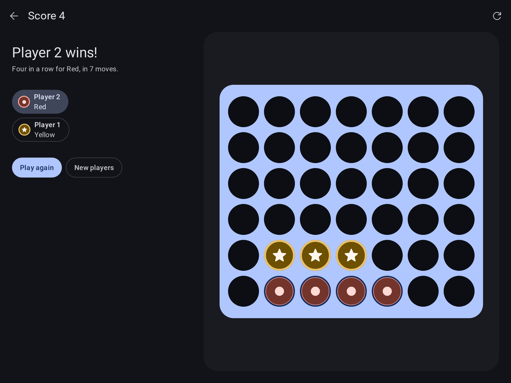

# Score 4 — case study

## The problem

Score 4 is Connect Four for two people at one keyboard. I wrote it in 2019 as a student project: one C++ file of 355
lines, run in a Windows console. Seven years later the question was simple: could it become something worth showing,
without losing what it did?

The first answer was no. Built with a current compiler on Linux, **the game never started**.

## Before

The 2019 program had no build file, no tests and no README. Running it showed why it needed more than a tidy-up:

| | |
| --- | --- |
|  |  |
| **As built**: a loop flag was never given a value, so the program quit right after the players picked colours. | **Vertical win**: with that flag forced to zero, the game worked for wins in a column. |
|  |  |
| **Missed diagonal**: four in a line going up to the right was never checked, so the game played on. | **Full column**: a seventh coin overwrote the top one, then the win check read outside the board and crashed. |

Other findings from the [audit](audit.md):

- The top row was never checked for a win.
- Typing a word instead of a number made the program ask the same question forever.
- It cleared the screen with the Windows-only `cls`, so on Linux and macOS every move printed an error.
- The board stored display text (`"R|"`) instead of a state, and the win checks were copied out by hand for every
  row and diagonal.

Every flow was recorded with scripted input, so the exact output of the old program became the expected output of
the first tests.

## Decisions

**Pin the behaviour before moving anything.** The first tests run the console program with the recorded inputs and
compare its output character by character. The 2019 bugs were kept, on purpose, until the code was restructured
under those green tests. Then each bug was fixed in its own commit, with its test changed in the same commit. That
way a refactoring mistake can never hide behind a fix.

**One game core, many front ends.** The rules now live in a small C++23 library with no input or output: a board, the
rules (where a coin lands, whether four line up and which four), and a game session. The console app is a thin layer
around it. Unit tests cover every rule, and the debug build runs them under AddressSanitizer and
UndefinedBehaviorSanitizer.

**Run the same core in the browser.** Rather than rewrite the rules in TypeScript, the core is compiled to
WebAssembly with Emscripten (24 kB). The web app never decides who won; it asks the engine. The console and the web
cannot drift apart, because there is only one implementation.

**Keep the original rules.** The younger player still starts, and the same age still means Player 1. The web version
keeps this rule and explains it on screen ("Player 2 is younger, so they start").

**Design first, in Figma, on Material 3.** Every screen and state was drawn before any UI code: setup, loading, engine
error, play, column full, the new game dialog, win and tie, at a phone width (412) and a desktop width (1024), with
dark versions of the key screens. The board uses the Material 3 kit's Blue colour mode, and the coins borrow its Red
and Yellow modes, so every colour is a kit value.

**Readable without colour.** Red coins carry a circle and Yellow coins a star. The four winning cells each get a ring,
because a win can be a row or a diagonal. The board is a grid of seven columns that works with the arrow keys, Home,
End and Enter, and every move is announced to screen readers.

**React with no effects.** The web app is React 19 with the React Compiler, a small Zustand store per screen and Base
UI for the dialog, radio group and snackbar. There is no `useEffect` anywhere: the engine loads through `use()` and
`<Suspense>`, a move is an event, and a new game is a new `key`. The rules behind these choices are in
[`docs/decisions.md`](../decisions.md).

## After

| Phone | Desktop |
| --- | --- |
|  |  |
|  |  |

- **It plays.** Every 2019 bug is fixed: all four directions count, the top row counts, a full column is refused with
  a clear message, bad input is asked again, and the screen clears on every terminal.
- **It is tested.** 24 C++ tests (rules, game and the recorded console flows), 22 component, store and service tests, and
  26 browser tests that play whole games at both Figma widths.
- **It is checked before every merge and every deploy.** CI runs the format check, clang-tidy, the sanitizer and release builds, the
  WebAssembly build, ESLint, the type check, the tests, a bundle-size budget and a check that no comment written for
  people slips into the code.
- **It is documented in plain words.** [`docs/rules.md`](../rules.md) explains the game,
  [`docs/architecture.md`](../architecture.md) how the parts fit, and [`docs/tooling.md`](../tooling.md) every tool
  and every switched-off rule.

## What I would do next

- Publish the web app so it can be played from a link.
- Add a computer opponent. The core already answers "where would this coin land" and "does this make four", which
  is most of what a simple opponent needs.
